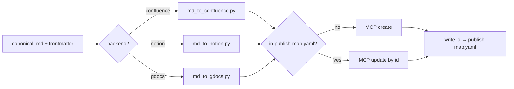

# publish/ — MD → KB publication pipeline

Canonical documentation is **Markdown** (`AGENTS.md` → Documentation Format & Publication).
This folder holds everything that turns a canonical `.md` into a published page/file in a
corporate KB, **without ever making Markdown the second-class copy**.

> [!IMPORTANT]
> Publishing is **manual and operator-initiated** (`AGENTS.md` Operating Principles §4).
> Nothing here runs on save, in bulk, or automatically. The conversion scripts are pure and
> safe to run anytime; the **transport** (the actual create/update in a KB) only happens
> when the operator says "go", via the [`doc-publish`](../.claude/skills/doc-publish/SKILL.md)
> skill / [`/publish`](../.claude/commands/publish.md) command.

## Roles (who does what)

| Part | Responsibility | Where it runs |
|------|----------------|---------------|
| **`doc-publish` skill** | Orchestrates: read doc + frontmatter + map, confirm with operator, call convert, call MCP, write map back | agent |
| **Conversion scripts** (`scripts/`) | **Pure** MD → backend-format. No network, no side effects | local, deterministic |
| **MCP / connector** | The actual transport (create/update the page/file) | Notion MCP · Google Docs connector · Confluence REST |
| **`publish-map.yaml`** | State: which KB object each doc maps to, for idempotent updates | repo sidecar |

## Pipeline (one document)

1. **Route** — `backend` + `target` frontmatter choose destination. `unit: multi` → publish
   the parent, then each child, recording every id.
2. **Convert** — the matching script emits backend payload; relative links / `[[wikilinks]]`
   rewritten to backend links (via the map), images collected as attachments/uploads.
3. **Transport** — create if the doc has no id for this backend in the map; otherwise update
   that id. **Dry-run first** (`--dry-run`) prints the payload without touching the KB.
4. **Record** — write `{backend: {id, url, version, published_at}}` back into the map.
5. **Confirm** — report the link(s); update the doc's changelog/`status` as the template
   dictates.

## Backend transport matrix

| Backend | Source format | Transport | Status |
|---------|---------------|-----------|--------|
| **Notion** | Notion blocks | **Notion MCP** (`notion-create-pages`, `notion-update-page`, `notion-fetch`) | active |
| **Google Docs** | Docs batchUpdate requests | **Google Docs connector** (first-party) / `google-workspace` skill | available |
| **Confluence** | storage format (XHTML) / ADF | **REST API** script (`/rest/api/content`) until an Atlassian MCP is wired | planned — needs base URL + space key + token |

## Idempotency — `publish-map.yaml`

One sidecar file is the source of truth for "where did this doc go". Keyed by the doc's
repo-relative path, then by backend. Example: [`publish-map.example.yaml`](publish-map.example.yaml).
Re-publishing a doc that already has an id **updates** that object; it never creates a
duplicate. Deleting a mapping (or passing `--new`) forces a fresh create.

## Scripts

Pure converters in [`scripts/`](scripts/) — run them standalone to preview output; they
never publish. The `doc-publish` skill calls them, then does the MCP transport itself.

- [`scripts/frontmatter.py`](scripts/frontmatter.py) — parse the YAML frontmatter + body.
- `scripts/md_to_confluence.py` · `scripts/md_to_notion.py` · `scripts/md_to_gdocs.py` —
  one converter per backend (skeletons; fill per backend format).

> These are **skeletons**: structure, CLI, and contract are defined; the per-backend
> format mapping is marked `TODO` and is filled when we publish against a live target.
