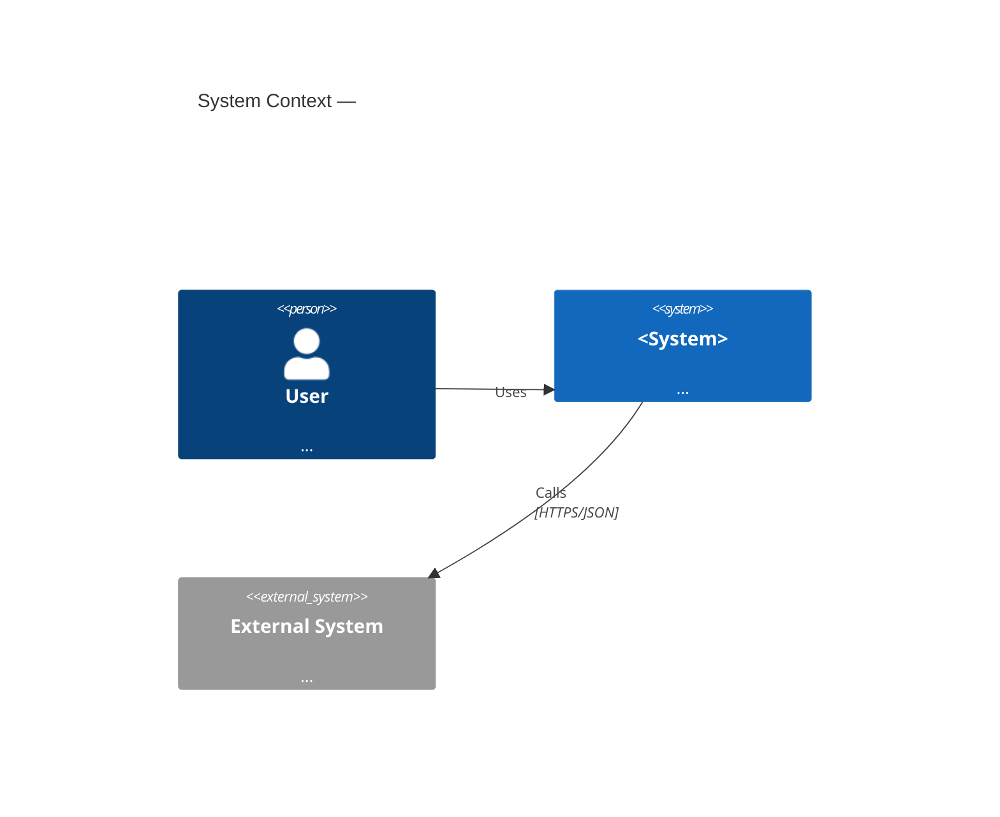
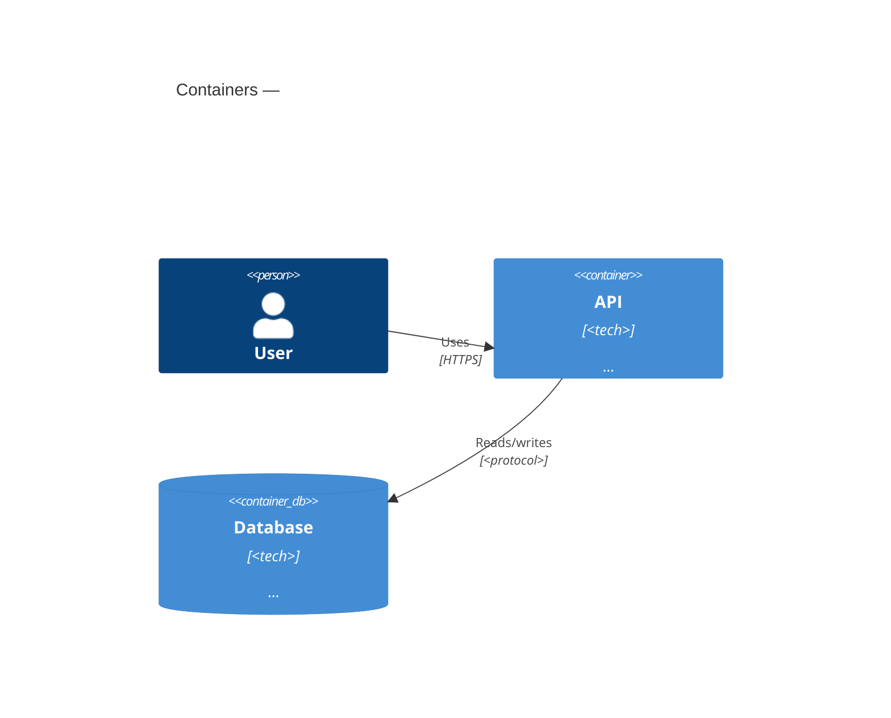
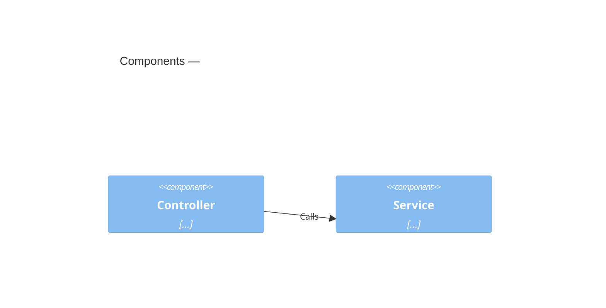

---
title: <System> — Architecture (C4)
author: System Architect Agent
owner: <team/role>            # accountable owner (mirrors CODEOWNERS)
created: YYYY-MM-DD
updated: YYYY-MM-DD
# version: n/a — lives with code; = service commit/release (AGENTS.md)
status: draft                # draft | review | approved | deprecated
type: architecture
applies_to: <service >= x.y>  # the code/version this describes
depends_on: []                # optional
backend: confluence
target: <space/parent or drive-folder or docs path>
unit: single
---

# <System> — Architecture (C4)

Structured on the **C4 model** (Context → Container → Component → Code). Each level zooms
in one step; include only the levels that add clarity (Code level usually optional).

## 1. Context (C4 L1)
The system as a black box: users, external systems, and their interactions.

## 2. Containers (C4 L2)
Deployable/runnable units (apps, services, datastores, queues) and how they communicate.

## 3. Components (C4 L3)
Inside a chosen container: its major components/modules and responsibilities.

## 4. Code (C4 L4) — optional
Only for the most critical component: key classes/functions (or a link to the code).

## 5. Cross-cutting
Deployment/topology, security boundaries, key data flows, and decisions (link [[ADR]]).
