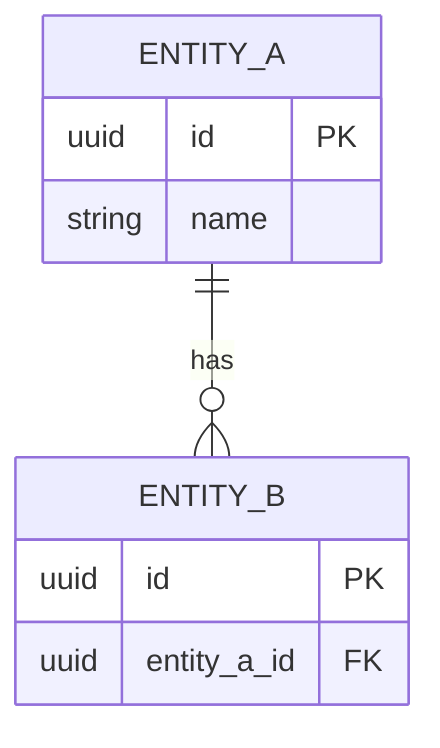

---
title: <System / Service> — Data Model
author: System Architect Agent
owner: <team/role>            # accountable owner (mirrors CODEOWNERS)
created: YYYY-MM-DD
updated: YYYY-MM-DD
# version: n/a — lives with code; = service commit/release (AGENTS.md)
status: draft                # draft | review | approved | deprecated
type: architecture
applies_to: <service >= x.y>  # the code/version this describes
depends_on: []                # optional
backend: confluence
target: <space/parent or drive-folder or docs path>
unit: single
---

# <System / Service> — Data Model

## 1. Overview
What data this system/service owns, and its role in the wider data landscape.

## 2. ER diagram

## 3. Entities
| Entity | Purpose | Key fields | Notes |
|--------|---------|-----------|-------|

### <Entity> — fields
| Field | Type | Null | Default | Constraints | Description |
|-------|------|------|---------|-------------|-------------|

## 4. Data ownership (who owns what)
> In a microservice system, **each datum has exactly one owning service** (source of truth).
> Everything else is a read copy / projection.

| Data / entity | Owning service | Shared with (read) | How shared (API / event / replica) |
|---------------|----------------|--------------------|-------------------------------------|

## 5. Migrations
How schema changes are managed (tool, naming, forward/rollback), and the
expand → migrate → contract approach for zero-downtime changes. Link [[ADR]] for notable
decisions.

| Migration | Date | Change | Backward-compatible? |
|-----------|------|--------|----------------------|

## 6. Retention & lifecycle
PII/sensitive fields, retention periods, archival/deletion rules.
