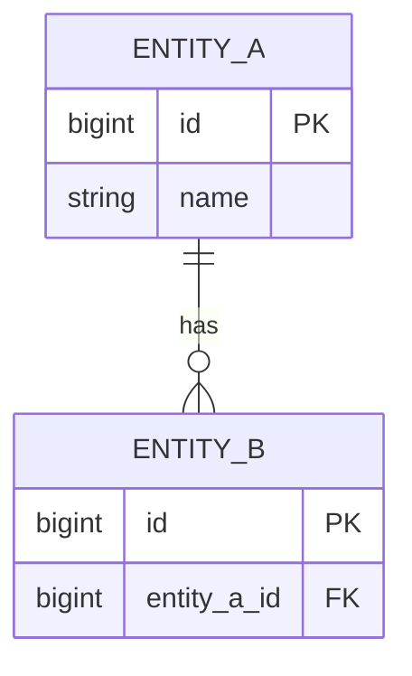

---
title: <System / Service> — Data Model
author: System Architect Agent
owner: <team/role>            # accountable owner (mirrors CODEOWNERS)
created: YYYY-MM-DD
updated: YYYY-MM-DD
# version: n/a — lives with code; = service commit/release (AGENTS.md).
# The data-model doc instead carries a schema_version in §1 (bumped per migration).
schema_version: <X.Y>         # structural schema version; bump on every migration (see §1, §5)
status: draft                # draft | review | approved | deprecated
type: architecture
applies_to: <service >= x.y>  # the code/version this describes
depends_on: []                # optional
backend: confluence
target: <space/parent or drive-folder or docs path>
unit: single
---

# <System / Service> — Data Model

> **DB-paradigm-aware.** §3 has two branches — fill the one matching your database and
> **delete the other**:
> - **§3A — Relational** (PostgreSQL, MySQL…): table structure.
> - **§3B — Document-oriented / JSONB** (MongoDB, Firestore, Couchbase… **or** a JSONB column
>   in a relational DB): collections + object/document structure, nesting via a hierarchical
>   `Номер` column.
>
> A polyglot service (e.g. PG tables + JSONB, or PG + Mongo) keeps **both** branches and names
> the engine per store.

## 1. Overview

- **Версия схемы / Schema version:** `<X.Y>` — bump on **every** migration that changes
  structure; mirror it in the frontmatter `schema_version`. This is the schema's own version,
  independent of the service release (AGENTS.md: docs version per group).
- **База данных / Database:** `<db name>` · engine `<PostgreSQL 15 | MongoDB 6 | …>` ·
  paradigm `<relational | document-oriented>`.
- What data this system/service **owns**, and its role in the wider data landscape.

## 2. Relationships diagram

Relational → ER diagram. Document-oriented → use the same diagram to show **references between
collections** (Mermaid has no native document-schema notation; model each collection as an
entity and draw `ref→` links as relationships).



## 3. Schema

> Keep **§3A** *or* **§3B** per store. Both use the same 4-column convention so the two
> paradigms read alike; the last column carries the constraint abbreviations.

### 3A. Relational — table structure

One subsection per table, headed `<schema>.<table>`. One row per column.

**`<имя схемы>.<имя таблицы>`**

| Название колонки | Описание | Тип данных | Значение |
|------------------|----------|------------|----------|
| `<column name>` | `<description>` — **must** include the value set when the column is constrained, e.g. статус: `0` — неактивен, `1` — активен | `BIGINT` | `PK` |
| … | … | `VARCHAR(50)` | `U`, `NOT NULL` |
| … | … | `BIGINT` | `FK → <schema>.<table>`, `I` |
| … | … | `BOOLEAN` | `NOT NULL`, `default true` |

> **Легенда столбца «Значение»** — ограничения с соответствующими аббревиатурами:
> Primary key — **PK** · foreign key — **FK** (укажи целевую таблицу: `FK → schema.table`) ·
> Index — **I** · unique — **U** · Not Null — **NOT NULL** · Default — **default `<значение>`**.
> Несколько ограничений — через запятую.

### 3B. Document-oriented / JSONB — collections & object structure

Applies to a document store (MongoDB, Firestore…) **and** to a JSONB column in a relational
DB. One subsection per collection (or per JSONB field), headed `<имя БД>.<имя коллекции>`.
One row per field; **nesting is expressed by the `Номер` column**, not by indentation.

**`<имя БД>.<имя коллекции>`**

| Номер | Название поля | Тип данных | Описание | Значение |
|-------|---------------|------------|----------|----------|
| `1` | `<field name>` | `string` | `<description>` — **must** include the value set when constrained, e.g. статус: `0` — неактивен, `1` — активен | `PK` |
| `2` | `<ref field>` | `string` | logical reference to another collection | `FK → <collection>` |
| `3` | `<object field>` | `object` | embedded object (its fields are `3.1`, `3.2`, …) | — |
| `3.1` | `<child field>` | `int` | nested one level under field `3` | `NOT NULL` |
| `3.2` | `<child array>` | `array` | array of sub-objects (element fields are `3.2.1`, …) | — |
| `3.2.1` | `<grandchild>` | `Boolean` | nested under `3.2` | `default true` |

> **Нумерация (столбец «Номер»):** порядковый номер `A.B.C.X.Y` и т.д., где **A** — родитель,
> **B** — его ребёнок, и так далее — номер кодирует вложенность объекта/документа.
>
> **Типы данных:** `string`, `date`, `Boolean`, `int` и другие валидные форматы JSON
> (`long`, `double`, `object`, `array`, …).
>
> **Легенда столбца «Значение»** — ограничения с соответствующими аббревиатурами:
> Primary key — **PK** · foreign key — **FK → `<collection>`** (логическая ссылка, целостность
> на стороне приложения) · Index — **I** · unique — **U** · Not Null — **NOT NULL** ·
> Default — **default `<значение>`**. Несколько ограничений — через запятую.

Example document (fill with real fields; keep it in sync with the numbering above):

```json
{
  "<field name>": "<value>",
  "<object field>": {
    "<child field>": 0,
    "<child array>": [ { "<grandchild>": true } ]
  }
}
```

## 4. Data ownership (who owns what)

> In a microservice system, **each datum has exactly one owning service** (source of truth).
> Everything else is a read copy / projection.

| Data / entity | Owning service | Shared with (read) | How shared (API / event / replica) |
|---------------|----------------|--------------------|-------------------------------------|

## 5. Migrations

How schema changes are managed (tool, naming, forward/rollback), and the
expand → migrate → contract approach for zero-downtime changes. **Bump the `schema_version`
(§1 + frontmatter) on every structural migration.** Link [[ADR]] for notable decisions.

| Migration | Date | schema_version | Change | Backward-compatible? |
|-----------|------|----------------|--------|----------------------|

## 6. Retention & lifecycle

PII/sensitive fields, retention periods, archival/deletion rules.
