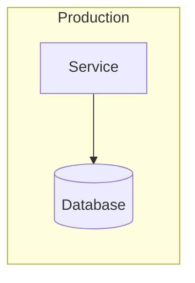

---
title: <System / Service> — Deployment & Infrastructure
author: System Architect Agent
owner: <team/role>            # accountable owner (mirrors CODEOWNERS)
created: YYYY-MM-DD
updated: YYYY-MM-DD
# version: n/a — as-code; current main branch is authoritative (AGENTS.md)
status: draft                # draft | review | approved | deprecated
type: documentation
applies_to: <service >= x.y>
depends_on: []                # optional
backend: confluence
target: <space/parent or drive-folder or docs path>
unit: single
---

# <System / Service> — Deployment & Infrastructure

> Much of this **is the code** (IaC, Helm, docker-compose, CI config). Describe and link
> the source of truth — do not duplicate it here; point to it.

## 1. Environments
| Environment | Purpose | URL / endpoint | Data | Who can deploy |
|-------------|---------|----------------|------|----------------|
| dev / staging / prod | … | … | … | … |

## 2. Topology
Where it runs (cluster / VMs / serverless), key infra components, external dependencies.
Link [[C4 architecture]].

## 3. CI/CD pipeline
Stages (build → test → package → deploy), triggers, gates/approvals, where it runs,
pipeline-as-code location.

## 4. Build & release artifacts
Artifact type (image/package), registry, tagging/versioning scheme (link [[Release Notes]]).

## 5. Configuration & secrets
- **Config:** where env/config lives per environment (names, not values).
- **Secrets:** the secret store and how secrets are injected. **Never** record secret
  values in this document.

## 6. Infrastructure as Code
IaC tool and repo/path (Terraform / Helm / docker-compose / Ansible). What it provisions.

## 7. Deploy, rollback & scaling
How to deploy a version, how to roll back, and how to scale. Link [[Runbook]] for incident
response.

## 8. Backups & DR
Backup schedule/location, restore procedure, RPO/RTO.
