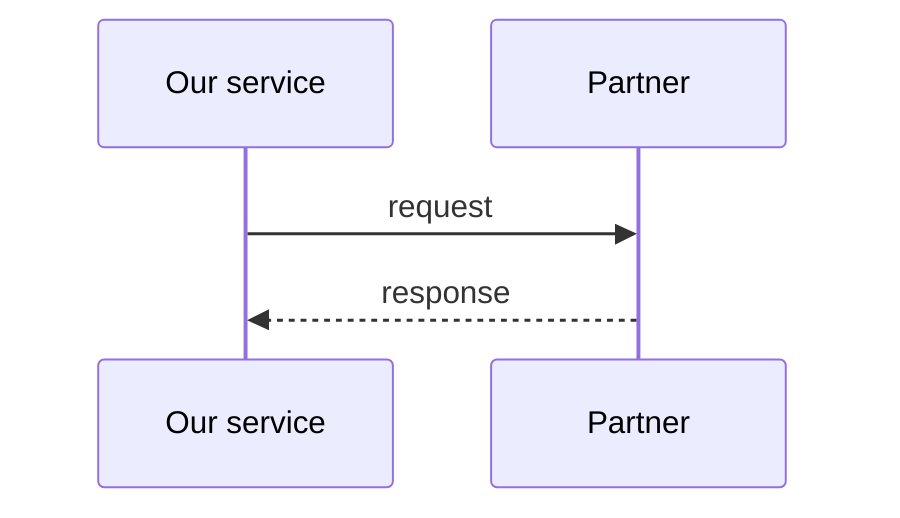

---
title: <Partner> — Integration (our side)
author: System Architect Agent
owner: <team/role>            # accountable owner (mirrors CODEOWNERS)
created: YYYY-MM-DD
updated: YYYY-MM-DD
version: 0.1.0                # doc version; changelog at end
status: draft                # draft | review | approved | deprecated
type: architecture
applies_to: <our-service >= x.y>
depends_on: []                # e.g. [acme-pay-api@5.x]
backend: confluence
target: <space/parent or drive-folder or docs path>
unit: single
---

# <Partner> — Integration (our side)

> The **technical** description of how *we* integrate with a partner (distinct from the
> API we expose — see [[Integration / API Contract]]). Pair it with the
> [[Partner integration registry]] entry and the [[Partner spec snapshot]].

## 1. Overview
What the integration does, direction (we call them / they call us / both), protocol.

## 2. Sequence

## 3. Data mapping
| Our field | Partner field | Transform / notes |
|-----------|---------------|-------------------|

## 4. Error handling & retries
Partner error model → our handling; timeouts, retry policy (counts, backoff,
idempotency), dead-letter/compensation, what we do when the partner is down.

## 5. Security
Auth scheme, where credentials/certs live (store ref, **not** values), mTLS/signing,
IP allowlists.

## 6. Environments & config
sandbox vs prod endpoints, config keys (names only). Link
[[Deployment & infrastructure]].

## 7. Monitoring & SLA
What we alert on, SLA we hold the partner to / they hold us to, dashboards. Link
[[Runbook]].

## 8. Decisions
Link the [[ADR]] on choosing this partner / integration approach.
